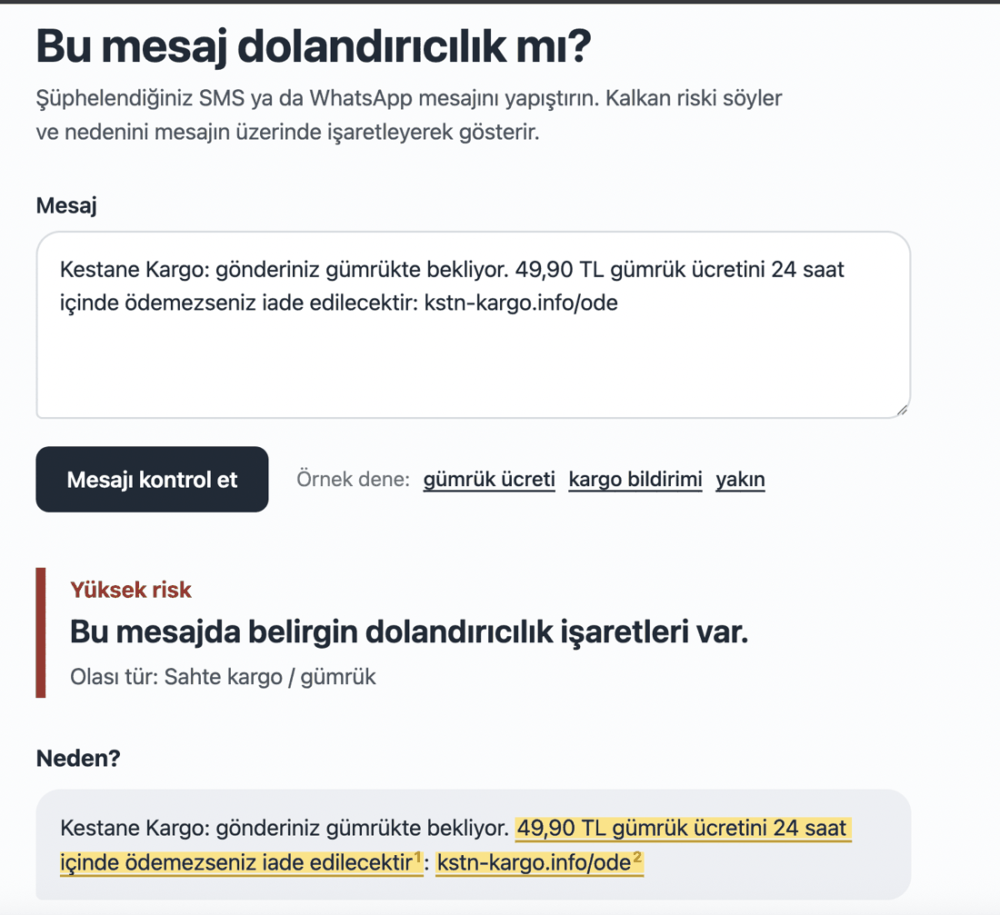
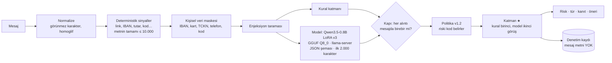

# 🛡️ Kalkan: Türkçe dolandırıcılık mesajı analizcisi

Şüpheli bir Türkçe SMS ya da WhatsApp mesajını alır; **risk**, **olası tür**, mesajdan **birebir alıntılanmış kanıtlar**
ve **ne yapılması gerektiğini** döndürür. Kanıtları model uyduramaz: her alıntının mesajda gerçekten geçtiğini kod
doğrular. Riski model değil kod belirler. Sistem hiçbir koşulda "güvenli" demez.

**Canlı demo:** https://kalkan-serhat.duckdns.org (4 vCPU'luk bir VPS, GPU yok; mesajlar saklanmaz)



**Projenin sorusu:** spam/ham ayrımı çözülmüş bir problem. Burada ölçülen şey şu: mesajı **dışarı göndermeden**
(ör. bir bankanın kendi sunucusunda) çalışabilen küçük bir model bu işe **yeter mi**, ve cevabına **neden
güvenilebilir**? Aynı cetvelde kural sistemi, TF-IDF, zero-shot küçük modeller, ince ayarlı küçük model ve
gpt-5.4-mini karşılaştırıldı.

> Portföy serisi 1/3 · "Güvenilir Türkçe AI": **A Kalkan** → D KAP Kanıt Analisti → G B2B Sipariş Ajanı

## Sonuç (golden set, 297 mesaj, tam sistem)

| Model | Makro-F1 | Dolandırıcılık recall | Meşru FPR | Saldırı sızıntısı | Nerede / maliyet |
|---|---|---|---|---|---|
| Kural sistemi | 0.887 | 0.975 | 0.000 | 1 / 30 ¹ | yerel, $0 |
| TF-IDF + lojistik regresyon | 0.689 | 1.000 | 0.000 | 3 / 30 | yerel, $0 |
| Qwen3.5-0.8B zero-shot | 0.128 | – | 1.000 | – | yerel |
| Qwen3.5-2B zero-shot | 0.236 | – | 0.43 | – | yerel |
| 0.8B LoRA v2 (Q8_0) | 0.507 | 1.000 | 0.296 | 0 / 30 | yerel |
| 0.8B LoRA v3 (Q8_0) | 0.552 | 1.000 | 0.019 | 1 / 30 | yerel |
| gpt-5.4-mini | 0.905 | 1.000 | 0.000 | 0 / 30 | bulut, ~$0.0012 / mesaj |
| **★ Kalkan: kural + 0.8B v3, katmanlı** | **0.905** | **1.000** | **0.019** | **0 / 30** | **yerel, $0** |

¹ Kural ve TF-IDF satırları politika katmanı olmadan, tür vekiliyle ölçüldü. Kural politika v1.2'den geçince sızıntı 0.

- **Yerel ve ücretsiz, gpt-5.4-mini ile aynı makro-F1.** Mesaj sunucudan çıkmaz.
- **Kör saldırı seti** (sonuçlara bakmadan yazılan 24 mesaj): 19 saldırıdan **1**'i sızdı; ayrıntı aşağıda.
- **Canlı sistemde gecikme** (HTTPS, 20 mesaj): p95 **6,9 sn**. Meşru mesajlar 1,5–2 sn, dolandırıcılık 4–7 sn
  (kanıtlı cevap daha uzun).
- FPR tek bir yanlış alarma dayanıyor (54 meşru mesajın 1'i); %95 güven aralığı **[0.003, 0.098]**. Aşağıdaki
  "Sınırlar" bölümünü okumadan bu sayıları kullanmayın.

Ayrıntılı tablo: [docs/eval-report.md](docs/eval-report.md) · Deney hikâyesi: [docs/rapor.md](docs/rapor.md)

## Nasıl çalışır



**Katmanlı karar** ([ADR-0006](docs/adr/0006-model-secimi-katmanli-karar.md)): kural sistemi türü ve taban riski verir.
Kural "düşük" derse, model yalnızca dolandırıcılık türü + kapıdan geçen en az 2 kanıt + bunlardan en az biri
ödeme/kod/kimlik **talebi** olduğunda riski "orta"ya çıkarabilir. Model riski **asla düşüremez**. Model cevap
veremezse sonuç "değerlendirilemedi" olur, "düşük" değil.

**Neden bu tasarım:** model tek başına "meşru"yu iyi tanımıyor (tür doğruluğu ~0.64); kural ise yazıldığı şablon diline
bağlı. Katmanlı yapıda ikisi birbirinin kör noktasını kapatıyor. Canlı örnek: "Kestane Kargo: gönderiniz gümrükte. 49,90 TL
ödeyin: …" mesajını model **meşru** saydı, kural yüksek dedi, kullanıcı yüksek gördü. Denetim kaydında
`kural_risk: yuksek · model_risk: dusuk` olarak duruyor.

## Güvenilirlik önlemleri

| Önlem | Ne yapar | Kanıt |
|---|---|---|
| Birebir alıntı kapısı | Mesajda geçmeyen hiçbir "kanıt" kullanıcıya gösterilmez | `kalkan/gate.py`, testli |
| Riski kod belirler | Model türü ve kanıtı önerir; risk ve öneri metni politikadan | [ADR-0005](docs/adr/0005-politika-guvenlik-agi.md) |
| "Güvenli" yasak | Şema bu kelimeyi içeren cevabı reddeder | [ADR-0004](docs/adr/0004-guvenli-kelimesi-yasak.md) |
| JSON şeması (gramer) | Model taksonomi dışı tür uyduramaz (gramersiz denemede uydurdu: "sahte_kojistik_…") | [Adım 8](docs/adim-08-gguf-eval.md) |
| Kişisel veri modelden önce maskelenir | IBAN, kart, TCKN, telefon, e-posta, tek kullanımlık kod | `kalkan/pii.py` |
| Kırpma saldırısı | 2.000 karakterden uzun mesajda kural metnin tamamını görür; kırpılan mesaj "düşük" alamaz | [Adım 9](docs/adim-09-katman-guvenlik.md) |
| Ölçülen = çalışan | Değerlendirme ve servis aynı karar kodunu çağırır; tekrar oynatma testi örnek örnek doğrular | `tests/test_katman.py` |
| Metinsiz denetim | Karar, katman, sinyal türleri, süre, tuzlu HMAC özeti; mesaj ve alıntı yok | `kalkan/denetim.py`, testli |
| BYOK anahtarı | Hata metinlerinden temizlenir; `vars()`/`repr`/pickle'da görünmez (test bir açık buldu, kapatıldı) | `tests/test_guvenlik.py` |
| Yayın | API ve model internete kapalı, yalnızca Caddy (HTTPS); SSH yalnızca anahtar; ufw; salt okunur konteynerler | [Adım 11](docs/adim-11-yayin.md) |

## Sınırlar (bilinen ve ölçülen)

1. **Veri sentetik.** Eğitim, doğrulama ve golden setler şablonlardan üretildi; şablonları ve kural sistemini aynı
   yazar (Claude, insan gözetiminde) yazdı. Golden'daki başarının bir kısmı şablon diline uyumdan geliyor olabilir.
   Gerçek, izinli SMS ile bağımsız bir değerlendirme **yok**.
2. **FPR belirsiz.** 1/54 yanlış alarm; %95 aralık [0.003, 0.098]. Gerçek oran %5'in üstünde olabilir.
3. **E-posta için uygun değil.** Gerçek e-posta setlerinde (OLTA-TR, UCI) sistem neredeyse her mesaja alarm veriyor
   (ayırt etme gücü ~+0.1). Kalkan bir SMS/WhatsApp aracı.
4. **Bilinen kaçırma:** BÜYÜK HARF + Türkçe karaktersiz, linksiz, "numarayı arayın" yönlendirmesi yapan mesajlar
   (kör set kor_10).
5. **Bilinen yanlış alarmlar:** meşru tek kullanımlık şifre bildirimleri (kural "şifre" kelimesini talep sayıyor);
   IBAN içeren meşru mesajlar, ör. arkadaşa "IBAN'ım şu" (politika v1.2, bilinçli); 2.000 karakterden uzun
   meşru mesajlar (kırpma kuralı, bilinçli).
6. **Tür etiketi zayıf.** Model dolandırıcılık türlerini birbirine karıştırıyor (doğrulamada ~0.64); kullanıcıya
   gösterilen tür çoğunlukla kuraldan gelir.
7. **Alan adı:** duckdns.org bazı DNS engel listelerinde; bazı kurumsal ağlar demoyu açmayabilir.
8. Kalkan bir karar yardımcısıdır, kesin hüküm vermez.

## Çalıştırma

**Gereksinim:** Python 3.11. Yerel model için llama.cpp (commit `5812201a8`) ve `kalkan-0.8b-v3-Q8_0.gguf`
(repoda yok; ağırlıklar `make export-ft` ile üretilir).

```bash
python3.11 -m venv .venv && source .venv/bin/activate
pip install -e ".[dev,eval,api]"
make test                    # 116 test

make sunucu-ft               # 1. terminal: llama-server (Q8_0)
make api                     # 2. terminal: http://127.0.0.1:8000
python -m kalkan --iz "Paketiniz gümrükte, 49,90 TL ödeyin: bit.ly/x9k2"
```

**Sunucuda (Docker):**
```bash
cd deploy && cp .env.ornek .env    # KALKAN_DENETIM_TUZ, KALKAN_ALAN_ADI, KALKAN_ACME_EPOSTA
docker compose up -d --build       # llama (kaynaktan, AVX2) + api + caddy (Let's Encrypt)
```

**Değerlendirmeyi yeniden üretmek** (model çağrısı olmadan, saniyeler): `make eval` (kural, TF-IDF) ·
`make katmanli` (katmanlı varyantlar, kaydedilmiş model çıktılarından) · `make rapor`.
Modelle: `make sunucu-ft` açıkken `make eval-sistem`.

## Teknik özet

| | |
|---|---|
| Model | Qwen3.5-0.8B, MLX LoRA (rank 16, tüm katmanlar, batch 2); 750 iterasyonluk eğitimin 450. kontrol noktası, Apple M4 16 GB'ta ~1 saat (~8,5 sn/iterasyon) |
| Eğitim verisi | 1.500 sentetik mesaj, 126 şablon, %40 meşru/reklam; kısa sistem istemi, kompakt JSON hedef |
| Dışa aktarma | adaptör → HF ağırlıklarına f32 birleştirme → GGUF → **Q8_0** (Q4_K_M tür doğruluğunu −0.091 düşürdü) |
| Çalışma zamanı | llama.cpp `llama-server` (commit 5812201a8), JSON şeması ile kısıtlı üretim |
| API | FastAPI 0.162, uvicorn 0.54; IP başına hız sınırı, tek yuvalı kuyruk, CSP |
| Yayın | Docker Compose (llama + api + Caddy 2.11), Ubuntu 24.04 VPS, 4 vCPU, 6 GB; RSS ~1,1 GB |
| Toplam bulut harcaması | $0.474 (yalnızca gpt-5.4-mini karşılaştırması) |

## Belgeler

**Rapor:** [deney hikâyesi](docs/rapor.md) · [eval raporu](docs/eval-report.md) · [veri kartı](docs/veri-karti.md) ·
[olay notu: dış set alıntıları](docs/olay-2026-11-22-dis-set-alintilari.md)

**Adımlar:** [spike](docs/spike-01-donusum.md) · [2 kurallar](docs/adim-02-kurallar-iskelet.md) ·
[3 veri](docs/adim-03-veri.md) · [4 eval](docs/adim-04-eval.md) · [5 pipeline](docs/adim-05-pipeline.md) ·
[6 gpt](docs/adim-06-gpt.md) · [7 fine-tune](docs/adim-07-finetune.md) · [8 GGUF + model seçimi](docs/adim-08-gguf-eval.md) ·
[9 katman + güvenlik](docs/adim-09-katman-guvenlik.md) · [10 API + arayüz](docs/adim-10-api-arayuz.md) ·
[11 yayın](docs/adim-11-yayin.md) · [12 sunum](docs/adim-12-sunum.md)

**Kararlar (ADR):** [0001 dönüşüm yolu](docs/adr/0001-finetune-donusum-yolu.md) ·
[0002 llama-server](docs/adr/0002-yerel-calisma-zamani-llama-server.md) · [0003 IBAN](docs/adr/0003-iban-hem-pii-hem-kanit.md) ·
[0004 "güvenli" yasak](docs/adr/0004-guvenli-kelimesi-yasak.md) · [0005 politika](docs/adr/0005-politika-guvenlik-agi.md) ·
[0006 model seçimi](docs/adr/0006-model-secimi-katmanli-karar.md)

## Veri ve gizlilik

Gerçek kişisel veri ile eğitim yapılmadı. Kurum adları ve bağlantılar kurgusal; bağlantılar hiçbir zaman ziyaret
edilmez, yalnızca statik analiz yapılır. Dış değerlendirme setleri (OLTA-TR, UCI Turkish Spam) yalnızca yerelde
kullanıldı; örnek bazlı sonuçları repoda yok ([olay notu](docs/olay-2026-11-22-dis-set-alintilari.md)). UCI seti
hiçbir dış API'ye gönderilmedi.
