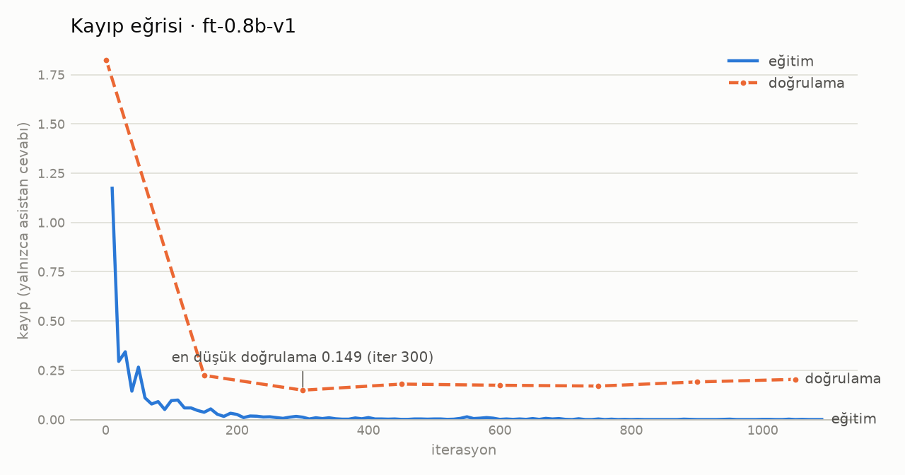

# Adım 7 — MLX LoRA fine-tune (Qwen3.5-0.8B) · v2 · 2026-11-21

## Neden?
Adım 5–6: aynı istem ve hatla zero-shot 0.8B tür makro-F1 0.13, 2B 0.24, gpt-5.4-mini 0.905. Sorun istem değil ölçek.
Küçük model görevi talimattan değil **örnekten** öğrenmeli. Hedef: banka modu (veri TR'de, yerel) ve 6 GB VPS'e sığan
bir modelle gpt-5.4-mini'ye yaklaşmak (H1).

## Akış
```
make sft-veri        data/splits/{egitim,dogrulama} → data/sft/{train,valid}.jsonl
make sablon-parite   eğitim metni = çalışma anı istemi mi? maske tam hedefin başında mı?   ← EĞİTİMDEN ÖNCE
make kontrol-08-temel  adaptörsüz ölçüm (aynı kod yolu, "önce")
make egit-08         LoRA v1 (batch 2, 1500 iter planı; 1080'de durduruldu), log → training/logs
make kontrol-08-it IT=300   belirli kontrol noktası (AD=ft-0.8b-v2 ile v2)
── Adım 7b ──
make veri sft-veri   şablon v1.3 → yeni bölümler
make sablon-paket    Gemini incelemesi → make sablon-iceri
make egit-v2         LoRA v2 (750 iter) → make loss-v2 → make kontrol-v2 (300/450/600/750) → seçilen: ft-0.8b-v2-it600
make loss            kayıp eğrisi PNG (docs/img/)
make kontrol-08      adaptörlü ölçüm ("sonra")
```
Adım 8: B yolu (spike) ile GGUF Q4_K_M → llama-server → tam eval (golden, adversarial, OLTA/UCI) + MLX↔GGUF paritesi.

## Kararlar
| Karar | Gerekçe |
|---|---|
| **Kısa sistem istemi** (419 karakter, tam istem ~3× uzun) | Model görevi örneklerden öğrenir. VPS'te prompt işleme ~130 tok/s (0.8B): soğuk istekte birkaç saniye kazanç. Eğitim ve çalışma anı AYNI kısa istemi kullanır (`--istem kisa`). |
| Hedef = kompakt tek satır JSON, `ensure_ascii=False` | Adım 2: girintili biçim ~2×, `\u` kaçışı ~1.8× token. Zero-shot 0.8B girintili yazıp 200 token'a çarpıyordu. |
| `mask_prompt: true` | Kayıp yalnızca cevapta. Sistem istemi + mesajı ezberlemeye kapasite harcanmaz. |
| Sohbet formatı + **parite testi** | MLX'in prompt/completion formatı istemi kendisi şablonlar (çift şablon riski). Qwen3.5'te şablonun "düşünme" bloğu maskeyi sessizce kaydırabilir → eğitimden önce ölç. |
| LoRA rank 16, scale 10, tüm katmanlar, lr 5e-5 cosine, batch 2 + grad checkpoint, 1500 iter (v1.1; v1 batch 4 → Metal OOM) | 0.8B küçük: tüm katmanlarda orta rank. ~2 epoch: sentetik veri tekrarlı, fazlası ezber riski. Doğrulama kaybı 150 iterde bir. Kötüleşirse en iyi kontrol noktası seçilir (save_every 150). |
| Taban: `.spike/base` (bf16, sha versions.lock'ta) | Spike'ta kanıtlandı: bf16 + kendi birleştirme script'imiz (B yolu) → GGUF doğru çalışıyor. |
| Golden ve adversarial eğitime GİRMEZ | Yalnızca egitim + dogrulama şablonları. Doğrulama yalnızca kayıp izleme ve kontrol noktası seçimi. |

## Tahminler (eğitimden önce)
| # | Tahmin |
|---|---|
| F1 | Parite testi: %50 ihtimalle bir uyumsuzluk çıkar (düşünme bloğu / maske ofseti) |
| F2 | Doğrulama kaybı ~300 iterde 0.15'in altına iner; eğitim–doğrulama farkı küçük kalır |
| F3 | MLX hızlı kontrol (doğrulama 198, gramersiz): JSON ≥ %98 · tür doğruluğu ≥ 0.85 · alıntı birebir ≥ %95 · ~65 çıktı token |
| F4 | Adaptörsüz (temel) aynı ölçümde: tür doğruluğu ≤ 0.25, JSON < %90 (gramer kısıtı yok) |
| F5 | Eğitim M4 16 GB'ta ≤ 20 dk, tepe bellek ≤ 6 GB |

## Sonuçlar v1 (şablon v1.2: tür başına 4 eğitim, 1 doğrulama şablonu)

Eğitim 1080. iterde durduruldu (ezber; aşağıda). Süre: ~8,5 sn/iter (~20 tok/s; gated delta net eğitimi MLX'te yavaş,
grad checkpoint ek yük) → 1500 iter ≈ 3,5 saat olurdu.

| iter | doğrulama kaybı | eğitim kaybı (yaklaşık) |
|---|---|---|
| 1 | 1.825 | – |
| 150 | 0.224 | 0.04 |
| **300** | **0.149** | 0.01 |
| 450 | 0.180 | 0.002 |
| 750 | 0.170 | 0.001 |
| 1050 | 0.204 | 0.000 |



Hızlı kontrol (doğrulama 198, MLX, gramersiz, greedy):

| | temel | it300 | it750 |
|---|---|---|---|
| JSON geçerliliği | 0.631 | 1.000 | 1.000 |
| tür doğruluğu | 0.000 | 0.500 | **0.581** |
| alıntı birebir | 0 alıntı | 0.986 | 0.992 |
| ort. çıktı token | 157 | 87 | 86 |
| süre (198 mesaj) | 554 sn | 383 sn | 380 sn |

**Karne:**
| # | Sonuç |
|---|---|
| F1 | ❌ (iyi haber) Parite tam: boş `<think>` bloğu hem eğitimde hem çalışma anında aynı yerde; maske doğru. |
| F2 | ◐ Doğrulama kaybı tam 300. iterde 0.149. Ama "fark küçük kalır" yanlış: sonrası ezber (eğitim → 0, doğrulama ↑). |
| F3 | ◐ Biçim ✅ (JSON 1.000, alıntı 0.99, ~86 token). Tür ❌ 0.58 (hedef ≥ 0.85). |
| F4 | ✅ Temel: tür 0.000, JSON 0.631. Kısa istem tek başına görevi tarif etmiyor; öğrenme şart. |
| F5 | ❌ Bellek: batch 4 OOM. Süre: 750 iter ≈ 1,8 saat (tahmin ≤ 20 dk). |

**İki ders:** (1) it750, doğrulama kaybı daha yüksek olduğu halde tür doğruluğunda daha iyi → bu görevde kayıp,
kontrol noktası seçimi için iyi bir vekil değil; seçim gerçek metrikle yapılır. (2) Kök neden aşağıda.

## Adım 7b — kök neden: şablon çeşitliliği

Karışıklık sayılarının hepsi **18**: doğrulamada her türün tek şablonu ve 18 örneği var. Yani bir türün TÜM örnekleri
topluca yanlış türe gidiyor ("hep ya da hiç"). Model türü anlamdan değil, gördüğü 4 kalıba yüzey benzerliğinden
öğrenmiş. Örnekler:
- `kargo_05` ("…bilgilendirme: depo ücreti … hesaplandı", sıklıkla ASCII) → **mesru_islem**: bilgilendirme tonu
  meşru kargo bildirimine benziyor. En pahalı hata (dolandırıcılık kaçırılıyor).
- `reklam_05` ("sepetinde unuttuğun ürünler… ücretsiz kargo!") → **sahte_kargo_gumruk**: "kargo" kelimesi + link.
- `kurum_05` (Dijital Vatandaş vergi iadesi) → kargo/ödül: eğitimde kurum_taklidi'nin hiç kamu markalı şablonu yoktu.

Sonuç: 1.496 eğitim örneği aslında 44 kalıbın varyasyonuydu; doğrulama da fiilen 11 "hep ya da hiç" ölçümüydü.
Kural modelinin golden'da 0.887 alması işaretlerin mesajda olduğunu gösteriyor; eksik olan model değil, veri çeşitliliği.

**Düzeltme (şablon v1.3):**
| | v1.2 | v1.3 |
|---|---|---|
| eğitim şablonu / tür | 4 | **10** (+66) |
| doğrulama şablonu / tür | 1 | **2** (+11) |
| test şablonu / tür | 2 | 2 (**dokunulmadı**: test.jsonl sha256 aynı → golden ve önceki tüm ölçümler geçerli) |
| eğitim örneği | 1.496 (şablon başına 34) | 1.496 (şablon başına 13–14): aynı süre, daha çok çeşit |

Yeni şablonlar bilinçli olarak sınıflar arası tuzak içerir: "kargo bedava" reklamı, şubede bekleyen **meşru** kargo,
şifre değişikliği bildirimi, kamu markalı kurum taklidi (trafik cezası, e-tebligat), linksiz/telefonlu kargo
dolandırıcılığı, IBAN'lı gümrük, hediye kartı isteyen yakın taklidi. İnceleme: Gemini şablon düzeyinde
(`make sablon-paket` → `sablon-iceri`), insan yalnızca işaretlenenlere bakar.

**Gemini sonucu (şablon v1.4):** 77 şablondan 69 doğru, 7 düzelt, 1 çıkar (F10 ✅: 8 işaret, tür itirazı 0).
- `kamu_09` (kapıdaki memura altın teslimi): canlı telefon senaryosu, SMS olarak gerçekçi değil → SMS'e uygun yeni
  metinle değiştirildi (Emniyet büro amirliği + memuru arayın + gizlilik), tür başına 10 şablon korunur.
- `kamu_12`, `kamu_14`: sesli arama ifadeleri ("arıyoruz", "söyleyin", "telefonu kapatmayın") SMS'e uyarlandı.
- `mesru_13`: iki bağımsız `{TARIH}` → hesap kesimi son ödemeden sonra olabiliyordu; tek tarihe indirildi.
- `mesru_14`, `reklam_08/10/12` (+ aynı sorunlu diğer yeni şablonlar): `{RESMI_LINK}`'in rastgele yolu ("/fatura" bir
  kampanyada) → yeni `{RESMI_SITE}` slotu, yol şablonda (`/kampanya`, `/degerlendir`…). Eski şablonlarda (test dahil)
  `{RESMI_LINK}` bilerek değiştirilmedi: test.jsonl sha256 aynı. Bilinen küçük kusur olarak not edildi.

**v2 eğitim:** `training/lora_v2.yaml`: v1 ile aynı, yalnızca 750 iter (~1 epoch; v1'de doğrulama kaybı dibi 300).
Kontrol noktaları 300/450/600/750 gerçek metrikle ölçülür (`make kontrol-v2`). Hızlı kontrol v1.1 ayrıca
şablon başına sonucu ve **kaçan dolandırıcılık / yanlış alarm** sayılarını verir. Kıyas için v1-it750 YENİ doğrulama
setinde de ölçülür (aynı cetvel).

### Tahminler (v2, eğitimden önce)
| # | Tahmin |
|---|---|
| F6 | v1-it750, yeni doğrulamada (22 şablon) tür ≈ 0.55–0.65 (eski 11 şablondaki 0.58'e yakın) |
| F7 | v2 en iyi kontrol noktası tür doğruluğu ≥ 0.80; tam bilinen şablon ≥ 17/22 |
| F8 | v2 en iyi nokta: kaçan dolandırıcılık ≤ %5, yanlış alarm ≤ %10 (politikadan önce, yalnızca tür) |
| F9 | v2'de en iyi nokta 450 veya 600 (kayıp dibi v1'deki gibi ~300 olsa bile) |
| F10 | Gemini 77 şablondan ≤ 8'ini işaretler; çoğu "duzelt" (dil), "tur" ≤ 3 |

### Sonuçlar v2 (şablon v1.4, 750 iter, ~1,9 saat)

| iter | doğrulama kaybı | tür | kaçan (dol.→meşru) | yanlış alarm | tam şablon |
|---|---|---|---|---|---|
| v1-it750 (kıyas, aynı yeni doğrulama) | – | 0.621 | 9/162 = %5.6 | 18/36 = %50 | 9/22 |
| 300 | 0.142 | 0.379 | 0 | 29/36 = %81 | 3/22 |
| 450 | 0.128 | 0.596 | 0 | 29/36 = %81 | 7/22 |
| **600** ← seçilen | **0.127** | 0.616 | **4/162 = %2.5** | 18/36 = %50 | 10/22 |
| 750 | 0.134 | 0.636 | 8/162 = %4.9 | 18/36 = %50 | 10/22 |

JSON 1.000 ve alıntı birebir ≥ 0.97 her noktada. Doğrulama kaybı v1'den düşük (dip 0.127 vs 0.149) ve ezber v1'deki gibi
sert değil; ama **tür doğruluğu yerinde saydı** (0.621 → 0.636).

**Seçim: it600.** 750 ile aynı yanlış alarm ve aynı tam şablon sayısı, tür farkı 0.02 (4 örnek), ama kaçan dolandırıcılık
yarısı (4 vs 8) ve doğrulama kaybı en düşük. Karar kuralında recall önce gelir.

**Kalan hatalar (it600/750, şablon düzeyinde):**
- **Güvenlik açısından önemli:** `kurum_14` (operatör "iki kez tahsil, iade edilecek, kart bilgisi girin") → **mesru_islem**.
  İade dili meşru bildirime benziyor. `mesru_05` (hesaba gelen EFT bildirimi) → yatirim_vip_grup; `reklam_05`
  (sepet hatırlatma + ücretsiz kargo) → gorev/odul. Yanlış alarmın tamamı bu iki şablon.
- **Dolandırıcılık türleri arası (alarm yine verilir):** "yetki/moderatör" dili → sahte_kamu_gorevlisi çekim merkezi
  (`oyun_14` moderatör, `kargo_14`, `kurum_05` kamu markalı vergi iadesi). Bunların bir kısmı taksonomi sınırında
  savunulabilir (kamu markalı kurum taklidi ↔ kamu görevlisi).

**Karne:**
| # | Sonuç |
|---|---|
| F6 | ✅ v1-it750 yeni doğrulamada 0.621 (tahmin 0.55–0.65) |
| F7 | ❌ En iyi tür 0.636, tam şablon 10/22 (tahmin ≥ 0.80, ≥ 17/22) |
| F8 | ◐ Kaçan %2.5 ✅ (≤ %5) · yanlış alarm %50 ❌ (≤ %10) |
| F9 | ✅ Seçilen 600 (kayıp dibi de 600) |
| F10 | ✅ Gemini 8 işaret, tür itirazı 0 |

**Ders:** "Darboğaz şablon çeşitliliği" hipotezi yalnızca kısmen doğrulandı: çeşitlilik ezberi yumuşattı ve kaybı düşürdü,
ama doğrulama tür doğruluğunu taşımadı. Kalan açıklamalar: (1) 0.8B'nin anlam kapasitesi; (2) doğrulama aracının kabalığı
(22 şablon, hep-ya-da-hiç → tek şablon ±0.045); (3) bir kısım hatanın taksonomi sınırında olması. Tür, kullanıcıya
gösterilen etiket; asıl karar (risk) politikada kanıt + deterministik sinyallerle verilir. Bu yüzden karar Adım 8'de
**golden üzerinde tam sistemle** (politika dahil) verilecek. Golden, bu adımda yazılan şablonlardan bağımsızdır.
Golden'da karar kuralı tutmazsa sıradaki aday: 2B fine-tune (≈2,5× süre) ya da deterministik sinyalleri model girdisine
ekleyen hibrit istem.

## Olay: ilk eğitim denemesi Metal OOM (v1 → v1.1)

`batch_size: 4`, `grad_checkpoint: false` ile ilk eğitim adımında `kIOGPUCommandBufferCallbackErrorOutOfMemory`.
Doğrulama geçişi (gradyansız) sorunsuzdu: val 1.826 (adaptörsüz başlangıç). Neden: Qwen3.5 sözlüğü ~248k;
çıktı logitleri batch × dizi uzunluğu × 248k boyutunda ve geri yayılımda kopyalarıyla birlikte tutuluyor; buna
24 katmanın aktivasyonları ekleniyor. M4 16 GB'ta GPU'ya ayrılan bellek toplamın ~%70'i.
Düzeltme: batch 2 + gradient checkpointing; iter 750 → 1500 (aynı veri miktarı), warmup/decay orantılı.
F5'in bellek kısmı (≤ 6 GB) v1 ayarlarıyla yanlış çıktı.
